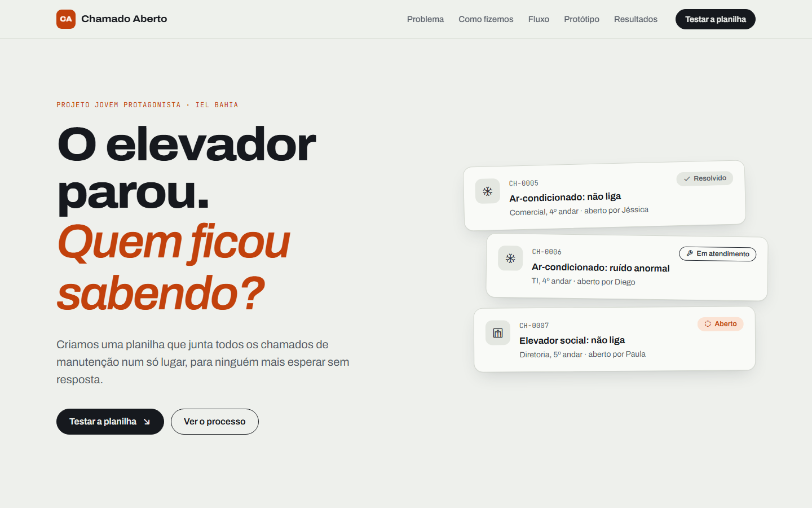

# Chamado Aberto

Site do projeto **Jovem Protagonista (IEL Bahia)**: uma planilha de gestão de chamados para reduzir o tempo de resposta na manutenção de elevadores e ar-condicionado.

**Acesse:** https://caioluiz-ads.github.io/chamado-aberto/



## O problema

Os pedidos de manutenção chegavam por canais diferentes (mensagem, corredor, "alguém já avisou?") e se perdiam no caminho. Não havia registro de quando um chamado era aberto ou resolvido, nem de quais equipamentos quebravam com mais frequência.

## A solução

Uma planilha padronizada com os campos **ID, Data de Abertura, Solicitante, Setor/Andar, Equipamento, Tipo de Problema, Status e Tempo de Resolução**, alimentada por dois formulários:

| Quem | O que faz |
| --- | --- |
| Funcionário | Abre o chamado informando setor, equipamento e problema |
| Suporte | Inicia o atendimento e conclui o chamado dizendo o que foi feito |

A planilha calcula sozinha o tempo de resolução, o tempo médio de atendimento e o equipamento com mais falhas.

## Testando o protótipo

Na seção **Protótipo** do site, entre com uma das contas de teste:

| Perfil | E-mail | Senha |
| --- | --- | --- |
| Funcionário | funcionarioteste@gmail.com | 123456789 |
| Suporte | suportetestes@gmail.com | 123456789 |

1. Entre como **funcionário** e abra um chamado.
2. Saia e entre como **suporte**.
3. Clique no status do chamado na tabela, inicie o atendimento e depois conclua.
4. Use **Baixar CSV** para abrir a planilha no Excel.

> O login é uma simulação para apresentação. Os dados ficam salvos apenas no navegador de quem está usando.

## Estrutura

```
chamado-aberto/
├── index.html          # Página do site
├── css/
│   ├── base.css        # Cores, tipografia, botões e navegação
│   ├── secoes.css      # Seções da página (abertura até o rodapé)
│   └── prototipo.css   # Login, formulários e tabela
├── js/
│   ├── dados.js        # Equipe, contas de teste e chamados de exemplo
│   ├── utils.js        # Formatação de datas e tempos
│   ├── estado.js       # Salvamento dos chamados no navegador
│   ├── planilha.js     # Tabela, indicadores, filtros e CSV
│   ├── login.js        # Entrada e saída das contas
│   ├── formularios.js  # Abrir chamado e atualizar chamado
│   └── main.js         # Inicialização da página
└── docs/
    └── preview.png     # Imagem usada neste README
```

Feito com HTML, CSS e JavaScript puros, sem instalação. Para rodar no computador, basta abrir o `index.html` no navegador.

## Equipe

Caio Luiz · Erick Mendes · Gabriel Carlos · Geovane Oliveira · Guilherme Gomes · Iasmin Lima · José Victor Seibert · Sofia Assis · Thauan Almeida · Vinicius Bisbo

## Referência

INSTITUTO EUVALDO LODI (IEL Bahia). *Diretrizes do Projeto Jovem Protagonista.* Salvador, 2026.
